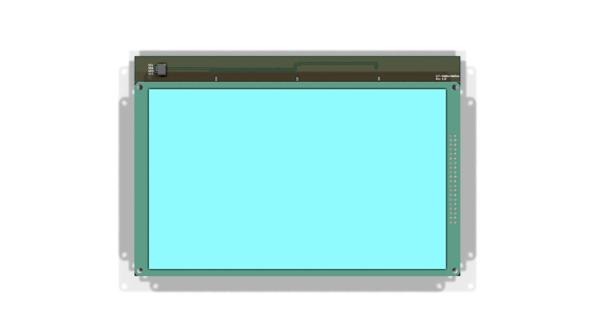
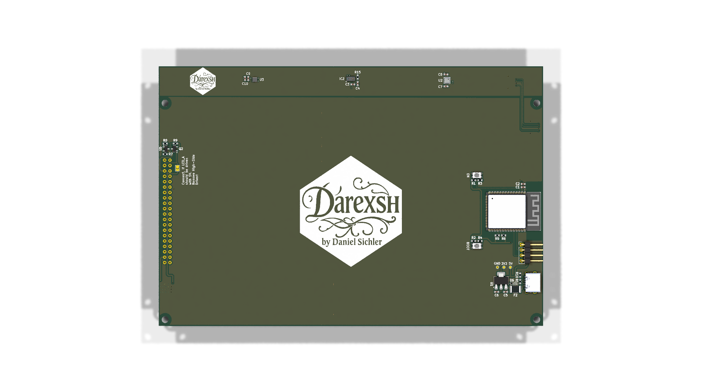
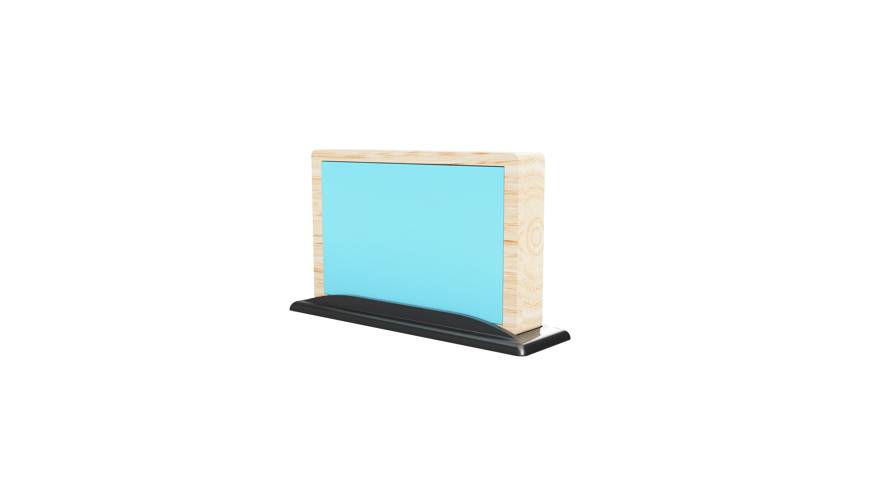

* * *

🌦️ ESP32-S3 Weather Station
============================

**A custom weather station with ESP32-S3, multiple sensors, and a 7" resistive TFT display**  
🖥️🌡️💧☀️🌐

   

   
Check out my bot in Telegram for an easy project overview. If you want to support more projects, you can leave a small donation for a coffee.

* * *

✨ Authors
---------

| Name | GitHub | Role | Contact | Contributions |
| --- | --- | --- | --- | --- |
| **[Darexsh by Daniel Sichler](https://github.com/Darexsh)** | [Link](https://github.com/Darexsh?tab=repositories) | Hardware & Firmware Development 🖥️🛠️, Display Integration 🎨 | 📧 [E-Mail](mailto:sichler.daniel@gmail.com) | Concept, Firmware, Display UI, Sensor Integration |

* * *

🚀 About the Project
--------------------

This project is a **custom weather station** based on the ESP32-S3 microcontroller. It combines multiple environmental sensors with a 7-inch resistive TFT display and a web interface to monitor data remotely and locally.

### 🛠️ Technologies

* **Microcontroller:** ESP32-S3
    
* **Sensors:** VCNL4040 (ambient light & proximity), BME688 (temperature, humidity, pressure, gas), LTR390-UV (UV index UVA/B)
    
* **Display:** 7" resistive TFT, connected via **DB0–DB7 (parallel interface)** with automatic brightness adjustment based on ambient light
    
* **Software:** C++, Arduino IDE / PlatformIO
    
* **Web Interface:** Hosted by ESP32-S3 for remote monitoring
    
* **Tools:** Git, Wireshark (optional for network debugging)
    

* * *

📋 Features
===========

* **🌡️ Environmental Measurements:** Temperature, humidity, pressure, air quality, ambient light, UV index
    
* **🖲️ Touchscreen Display:** 7" resistive TFT with local visualization of all sensor data
    
* **💡 Automatic Brightness:** Display dims based on ambient light from VCNL4040
    
* **🌐 Web Dashboard:** Access real-time sensor data remotely via a browser
    
* **📊 Historical Logging (optional):** Track trends for temperature, humidity, and UV exposure
    
* **⚡ Alerts & Automation (optional):** Configure thresholds for UV, temperature, and air quality
    

* * *

🔧 Hardware Setup
-----------------

* **ESP32-S3 microcontroller**
    
* **VCNL4040, BME688, LTR390-UV sensors** connected via I2C
    
* **7-inch resistive TFT touch display** connected via **DB0–DB7 (parallel interface)**
    
* Compatible **power supply** for ESP32-S3 and TFT display
    

* * *

🚀 Installation & Usage
-----------------------

1. Flash the firmware to ESP32-S3 using **Arduino IDE** or **PlatformIO** 💾
    
2. Connect sensors and display according to the wiring diagram 🔌
    
3. Power on the device 🔋
    
4. Access the **web dashboard** via Wi-Fi 🌐 to view sensor data in real-time
    
5. Use the touchscreen to navigate local measurements 🖲️
    

* * *

## 📜 License

This project is licensed under the **MIT License**.

This license applies to the updater application code in this repository. Upstream patch and app projects remain under their own licenses and notice terms.

**Copyright (c) 2025 Darexsh by Daniel Sichler**

You are free to use, copy, modify, merge, publish, distribute, sublicense, and sell this software under the terms of the MIT License.

When redistributing this project, you must include the original copyright notice and the MIT License permission notice.

**Developer:** Darexsh by Daniel Sichler.

The full license is available in the [LICENSE](LICENSE) file.

* * *

<!-- Keep this line! Rendered picture of PCB is going to be displayed after Production files are pushed to branch! -->

 Created with ❤️ by Daniel Sichler 

